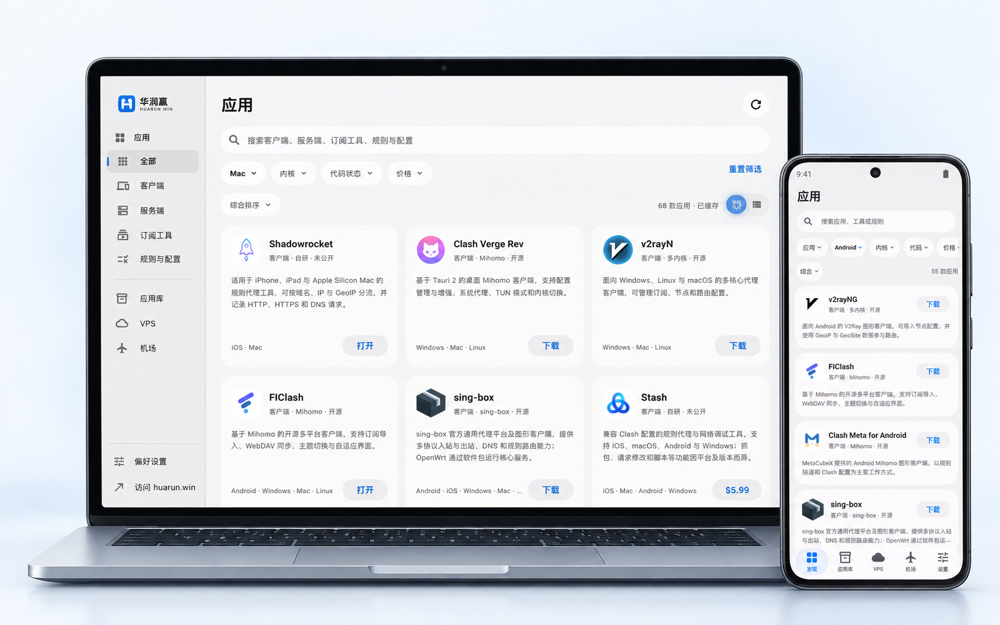

<div align="center">


# 华润赢 · HuarunWin

跨平台的翻墙应用商店，让发现、下载和安装更简单。

[](https://flutter.dev/)
[](#下载)
[](LICENSE)

[网站](https://huarun.win/) · [下载](#下载) · [项目文档](docs/README.md) · [问题反馈](https://github.com/huarunwin/huarunwin/issues)

</div>

<p align="center">
  <picture>
    <source media="(prefers-color-scheme: dark)" srcset="docs/images/preview-dark.png">
    
  </picture>
</p>

华润赢是一个跨平台的翻墙应用商店，汇集代理客户端、服务端、订阅工具、规则与配置，帮助你发现、下载、安装和管理翻墙工具，同时提供 VPS 与机场的公开资料。

应用资料来自 [huarun.win](https://huarun.win/)，支持手机、平板与桌面布局。项目源码按 [Source Available 许可](LICENSE)提供查阅与审计。

## 功能

- **发现翻墙工具**：浏览代理客户端、服务端、订阅工具、规则与配置，按类型搜索，按平台、内核、代码状态和价格筛选客户端。
- **应用详情**：查看版本、更新说明、截图与官方渠道，按实际平台和架构选择安装包。
- **应用库**：集中查看下载任务、已安装与待安装的应用，以及可确认的更新；支持搜索、筛选、取消和重试。
- **Android 安装与 APK 处理**：导入本地 APK，经系统确认安装；可选个人密钥重签、修改包名，以及密钥导入与备份。
- **macOS 安装助手**：处理 DMG／ZIP 中的应用，检查应用身份、签名与架构，确认后安装或替换。
- **VPS 与机场**：浏览公开资料，按条件搜索与筛选，在应用内查看详情。
- **适应不同屏幕**：手机、平板与桌面布局，浅色／深色主题和本地缓存；无内置广告、分析统计或崩溃上报。

## 下载

正式版见 [GitHub Releases](https://github.com/huarunwin/huarunwin/releases/latest)，测试版见 [预发布页面](https://github.com/huarunwin/huarunwin/releases/tag/pre)。

| 平台 | 安装包 | 说明 |
| --- | --- | --- |
| Android | `arm64`、`armv7`、`x64` APK | 大多数手机选择 `arm64`；其余按设备 ABI 选择。 |
| macOS 13 及以上 | `arm64`、`amd64` DMG | Apple Silicon 选择 `arm64`，Intel 选择 `amd64`。 |
| Windows | `amd64`、`arm64` 安装版 EXE／便携 ZIP | x64 需 Windows 10 1809 及以上，ARM64 需 Windows 11；ZIP 完整解压后运行。 |

流水线配置支持以上三类安装包，各版本以 Release 实际附件为准。Linux 与 iOS 的能力和构建条件见[项目文档](docs/README.md)；各平台的实际验证范围见[验证记录](docs/verification.md)。

## 常见问题排查

**macOS 提示“应用已损坏，无法打开”或“无法验证开发者”？**

macOS 安装包目前使用 ad-hoc 签名，尚未接入 Apple Developer ID 签名和公证，首次打开时可能被 Gatekeeper 拦截。确认安装包来自本项目 GitHub Releases，并核对 `.sha256` 附件中的校验值后，可以按以下方式处理：

1. 将应用拖入“应用程序”文件夹，打开“终端”，执行：

   ```sh
   xattr -rd com.apple.quarantine "/Applications/华润赢.app"
   ```

2. 或者在“系统设置 → 隐私与安全性”中点击“仍要打开”（如系统提供此按钮），按提示确认。

上述命令仅移除该应用的下载隔离标记，不等于签名或公证，也不能修复安装包损坏、无效签名或架构不兼容。仍无法打开时，请重新下载与设备架构对应的安装包。

## 反馈与文档

功能建议、问题和审计结论请提交到 [GitHub Issues](https://github.com/huarunwin/huarunwin/issues)，安全漏洞请按 [SECURITY.md](SECURITY.md) 私密报告。提交前请移除日志与截图中的个人信息。

功能、架构、安装、发布及验证资料见[文档索引](docs/README.md)，客户端数据处理方式见[隐私说明](docs/privacy.md)。修改代码或提交补丁前须取得著作权人的书面授权，并阅读 [AGENTS.md](AGENTS.md)。

## 许可与致谢

本项目采用[华润赢源码查看与审计许可 1.0](LICENSE)，属于源码公开（Source Available）项目。允许查看、安全审计、原样本地编译验证与个人使用；未经书面授权不得修改、制作衍生版本或再分发源码及安装包，具体范围与例外以许可正文为准。名称与 Logo 的品牌权利保留。公开源码不构成安全认证，也不证明安装包与源码一致。

第三方依赖遵循各自许可证，其权利不受项目许可缩减。项目许可与第三方许可可在“设置 → 软件许可”查看，随附的原生依赖声明位于 [assets/licenses](assets/licenses/)。

感谢 [Flutter](https://flutter.dev/)、[FlClash](https://github.com/chen08209/FlClash)、[Komi Store](https://github.com/komi-store/komi-store) 和 [AppManager](https://github.com/MuntashirAkon/AppManager) 提供的工具与设计参考。界面与流程独立实现；Android APK 修改使用 [ARSCLib](https://github.com/REAndroid/ARSCLib)（Apache-2.0），并参考 [APKEditor](https://github.com/REAndroid/APKEditor) 与 [Apktool](https://github.com/iBotPeaches/Apktool)。
